# Desarrollo de la demostración — TP4

## Fase 0 — Diseño de la red

### 0.1. Objetivo y alcance

La demostración utiliza dos proyectos independientes en GNS3:

- **EMPRESA:** representa la red operativa y permite consultas de lectura.
- **GEMELO:** reproduce el escenario y permite probar correcciones.

Se investigará un bloqueo de firewall, se probará una solución en GEMELO y se entregará una recomendación sin modificar EMPRESA.

El gemelo se preparará manualmente. No se implementarán sincronización automática, descubrimiento de dispositivos ni control del inicio de nodos.

### 0.2. Topología y dispositivos

Cada proyecto tendrá tres MikroTik CHR, dos VPCS, un switch de gestión y una Cloud conectada a la red Host-only.

| Equipo | Función |
|---|---|
| R1 | Conecta la LAN de usuarios |
| R2 | Proporciona un camino alternativo |
| R3 | Conecta la LAN del servidor |
| PC | Inicia las pruebas de conectividad |
| SRV | Representa el destino de las pruebas |
| Switch y Cloud | Permiten administrar los routers desde Windows |

Los routers forman un triángulo. El enlace R1–R3 será el camino principal y R1–R2–R3 será la alternativa.

SRV es un VPCS: se comprobará conectividad ICMP, no servicios de aplicación.

### 0.3. Cableado

El esquema se repite en ambos proyectos con dispositivos independientes.

| Extremo A | Interfaz A | Extremo B | Interfaz B |
|---|---|---|---|
| PC | Ethernet0 | R1 | ether2 |
| SRV | Ethernet0 | R3 | ether2 |
| R1 | ether3 | R2 | ether3 |
| R2 | ether4 | R3 | ether3 |
| R1 | ether4 | R3 | ether4 |
| R1 | ether1 | Switch de gestión | Puerto 0 |
| R2 | ether1 | Switch de gestión | Puerto 1 |
| R3 | ether1 | Switch de gestión | Puerto 2 |
| Switch de gestión | Puerto 3 | Cloud | Interfaz Host-only |

En GNS3, `e0` corresponde a `ether1` de RouterOS, `e1` a `ether2`, y así sucesivamente. En R2, `ether2` queda libre.

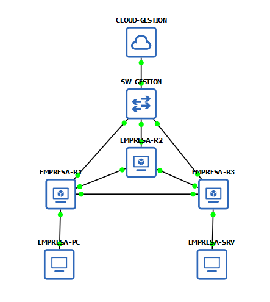

*Figura 1: Topología de EMPRESA y conexiones de gestión.*

### 0.4. Plan de direccionamiento

#### Gestión

Se reservará `ether1` para administración.

| Router | EMPRESA | GEMELO |
|---|---|---|
| R1 | 192.168.57.10/24 | 192.168.57.20/24 |
| R2 | 192.168.57.11/24 | 192.168.57.21/24 |
| R3 | 192.168.57.12/24 | 192.168.57.22/24 |

Se eligen IP estáticas para mantener accesos conocidos y evitar depender de concesiones DHCP. Las direcciones deberán estar libres y fuera del pool DHCP.

Se deshabilitará únicamente el cliente DHCP de estas interfaces para evitar una segunda dirección dinámica innecesaria. Esto no impide usar DHCP en otras redes.

Las interfaces de gestión tendrán direcciones MAC únicas entre ambos
proyectos, ya que comparten la red Host-only. Al clonar los routers
se comprobará este requisito, además de asignar IP de gestión distintas.

#### Redes internas

| Segmento | Extremo A | Extremo B |
|---|---|---|
| LAN usuarios — 10.10.0.0/24 | R1 ether2: 10.10.0.1 | PC: 10.10.0.10 |
| LAN servidor — 10.20.0.0/24 | R3 ether2: 10.20.0.1 | SRV: 10.20.0.10 |
| R1–R2 — 10.0.12.0/30 | R1 ether3: 10.0.12.1 | R2 ether3: 10.0.12.2 |
| R2–R3 — 10.0.23.0/30 | R2 ether4: 10.0.23.1 | R3 ether3: 10.0.23.2 |
| R1–R3 — 10.0.13.0/30 | R1 ether4: 10.0.13.1 | R3 ether4: 10.0.13.2 |

PC utilizará gateway `10.10.0.1` y SRV, `10.20.0.1`.

Los enlaces entre routers usarán `/30` porque necesitan dos direcciones de host. Las LAN usarán `/24` para mantener un esquema sencillo y diferenciar usuarios de servidores.

#### Loopbacks

| Router | Dirección en lo | Router ID |
|---|---|---|
| R1 | 10.255.0.1/32 | 10.255.0.1 |
| R2 | 10.255.0.2/32 | 10.255.0.2 |
| R3 | 10.255.0.3/32 | 10.255.0.3 |

Se utilizará la interfaz `lo` nativa de los CHR y se configurarán los Router ID explícitamente.

Las IP internas se repetirán en GEMELO porque sus redes de datos estarán separadas de EMPRESA. Las direcciones de gestión serán diferentes para acceder simultáneamente a ambos entornos.

### 0.5. Enrutamiento

Se utilizará OSPFv2 en el área backbone `0.0.0.0`.

| Enlace | Costo por extremo |
|---|---|
| R1–R3 | 10 |
| R1–R2 | 20 |
| R2–R3 | 20 |

Los costos favorecerán el enlace directo R1–R3. OSPF se elige para intercambiar rutas y disponer de un camino alternativo sin configurar rutas estáticas para cada destino.

Las vecindades se formarán únicamente entre routers. Las LAN y loopbacks serán pasivas; la red de gestión no participará en OSPF.

Se verificarán vecinos FULL, rutas a las LAN remotas y preferencia del camino principal. La autenticación OSPF queda fuera de esta configuración inicial.

### 0.6. Seguridad y separación de entornos

Se aplicarán estos controles:

- SSH restringido al equipo administrador autorizado.
- Cuentas específicas y deshabilitación de servicios innecesarios.
- Lectura en EMPRESA y modificaciones controladas en GEMELO durante la demo.
- Bloqueo del tránsito entre las redes de datos y la interfaz de gestión.
- Contraseñas fuera del repositorio y de las capturas.

No se conectarán entre sí las LAN de ambos proyectos ni se crearán bridges entre gestión y datos.

GEMELO tendrá nodos, discos, identidades y credenciales independientes. Antes de utilizarlo se comprobará que reproduce la configuración relevante y el comportamiento de EMPRESA.

### 0.7. Falla y criterios de éxito

Se introducirá en R1 una regla que bloquee por error ICMP desde `10.10.0.10` hacia `10.20.0.10`. Los enlaces y OSPF permanecerán funcionando.

La política del laboratorio permitirá ese tráfico, pero bloqueará desde PC el acceso a la loopback de R3 (`10.255.0.3`). Este segundo destino permitirá verificar que la corrección conserva una restricción de seguridad.

| Comprobación tras corregir GEMELO | Resultado esperado |
|---|---|
| GEMELO-PC → 10.20.0.10 | Responde |
| GEMELO-PC → 10.255.0.3 | Sigue bloqueado |
| OSPF y rutas de GEMELO | Continúan operativos |
| EMPRESA-PC → 10.20.0.10 | Sigue bloqueado |

Se contrastarán los pings con los contadores del firewall. Un timeout por sí solo no demuestra que una regla esté bloqueando tráfico.

La solución será válida si recupera la comunicación permitida sin eliminar los bloqueos requeridos. No se aceptará desactivar todo el firewall.

Las pruebas desde VPCS serán manuales. Se realizarán tres recorridos completos y se preparará una grabación de respaldo.

## Fase 1 — Identificación y acceso de gestión

### 1.1. Objetivo

Establecer nombres y direcciones estáticas de gestión para los tres routers, y comprobar su acceso mediante SSH desde Windows.

### 1.2. Inspección

Se consultaron las interfaces, direcciones y servicios disponibles:

```routeros
/system identity print
/interface print
/ip address print
/ip dhcp-client print
/ip service print
```

Se identificó `ether1` como interfaz de gestión y se comprobó que los routers disponen de una interfaz loopback nativa llamada `lo`.

### 1.3. Configuración de los routers

Los siguientes comandos permiten reproducir la configuración. Antes de ejecutar una instrucción `add`, se debe comprobar que la dirección no exista para evitar duplicados.

#### EMPRESA-R1

```routeros
/system identity set name=EMPRESA-R1
/ip address add address=192.168.57.10/24 interface=ether1 comment="Gestion fija MCP"
/ip dhcp-client disable [find where interface=ether1]
```

#### EMPRESA-R2

```routeros
/system identity set name=EMPRESA-R2
/ip address add address=192.168.57.11/24 interface=ether1 comment="Gestion fija MCP"
/ip dhcp-client disable [find where interface=ether1]
```

#### EMPRESA-R3

```routeros
/system identity set name=EMPRESA-R3
/ip address add address=192.168.57.12/24 interface=ether1 comment="Gestion fija MCP"
/ip dhcp-client disable [find where interface=ether1]
```

El comentario es una etiqueta administrativa y no afecta el funcionamiento de la dirección.

### 1.4. Decisiones tomadas

- **Identidades diferentes:** permiten reconocer cada router en las consolas y sesiones remotas. El nombre del nodo en GNS3 no reemplaza la identidad de RouterOS.
- **Direcciones estáticas:** mantienen accesos conocidos sin depender de concesiones DHCP.
- **Cliente DHCP deshabilitado en ether1:** evita recibir una dirección dinámica adicional en gestión. No implica deshabilitar DHCP en toda la red.
- **Interfaz dedicada a gestión:** separa el cableado de administración del utilizado para las LAN y los enlaces entre routers.

Las restricciones de acceso y los permisos definitivos se configurarán en la fase de seguridad.

### 1.5. Verificación

En cada router se ejecutaron:

```routeros
/system identity print
/ip address print
/ip dhcp-client print
```

Las capturas muestran el siguiente estado:

| Router | Identidad | Dirección en ether1 | Cliente DHCP |
|---|---|---|---|
| R1 | EMPRESA-R1 | 192.168.57.10/24 | Deshabilitado |
| R2 | EMPRESA-R2 | 192.168.57.11/24 | Deshabilitado |
| R3 | EMPRESA-R3 | 192.168.57.12/24 | Deshabilitado |

Las direcciones aparecen sin la bandera `D` de dinámicas. El cliente DHCP muestra la bandera `X` de deshabilitado.

Los valores `yes` en `USE-PEER-DNS` y `ADD-DEFAULT-ROUTE` son opciones del cliente; no indican que esté activo.

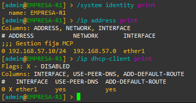

*Figura 2: Configuración de gestión de EMPRESA-R1.*

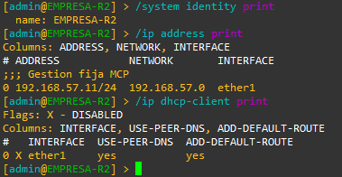

*Figura 3: Configuración de gestión de EMPRESA-R2.*

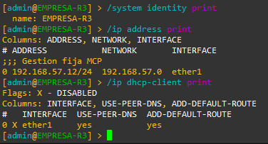

*Figura 4: Configuración de gestión de EMPRESA-R3.*

### 1.6. Acceso SSH desde Windows

Cada conexión se realiza por separado:

```powershell
ssh admin@192.168.57.10
ssh admin@192.168.57.11
ssh admin@192.168.57.12
```

En el primer acceso, la huella de la clave de host debe verificarse antes de aceptarla.

Dentro de la sesión se consulta:

```routeros
/system identity print
```

La identidad debe coincidir con el router de destino. Para cerrar la sesión:

```routeros
/quit
```

Se comprobó el acceso a los tres routers. La siguiente captura muestra la conexión a EMPRESA-R2 como ejemplo representativo.

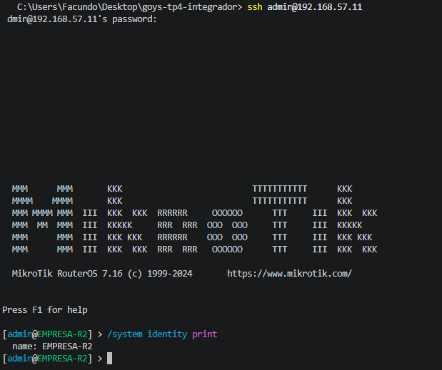

*Figura 5: Verificación del acceso de administración mediante SSH.*

Las contraseñas se ingresan localmente y no se incluyen en capturas ni archivos del repositorio.

### 1.7. Resultado 

Los tres routers quedaron identificados y accesibles mediante sus direcciones estáticas de gestión.

Se comprobó que VMnet1 utiliza el rango DHCP
192.168.57.128–192.168.57.254. Las direcciones estáticas
de EMPRESA y las previstas para GEMELO quedan fuera de ese rango.

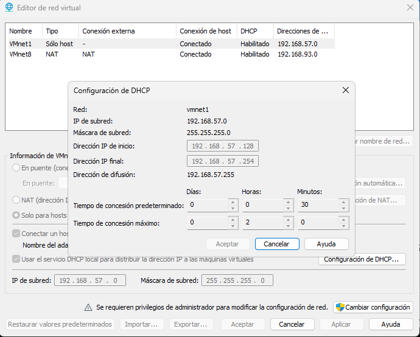

*Figura 6: Rango DHCP de la red de gestión.*
Esta fase verifica el acceso de administración. La conectividad entre LAN se comprobará después de configurar el direccionamiento interno y OSPF.

La cuenta `admin` se utiliza temporalmente durante el armado. Las cuentas definitivas y las restricciones de servicios se configurarán en la fase 4.

## Fase 2 — Direccionamiento interno y hosts

### 2.1. Objetivo

Asignar direcciones a las LAN, los enlaces entre routers, las loopbacks y los hosts. Verificar conectividad entre vecinos directos antes de configurar OSPF.

### 2.2. Configuración de los routers

Se conservaron las direcciones de gestión de `ether1`. Las direcciones internas se asignaron según el diseño de F0.

Los siguientes comandos documentan la configuración aplicada. No deben repetirse sin comprobar las entradas existentes.

#### EMPRESA-R1

```routeros
/ip address add address=10.10.0.1/24 interface=ether2 comment="F2 LAN usuarios"
/ip address add address=10.0.12.1/30 interface=ether3 comment="F2 enlace R1-R2"
/ip address add address=10.0.13.1/30 interface=ether4 comment="F2 enlace R1-R3"
/ip address add address=10.255.0.1/32 interface=lo comment="F2 loopback R1"
```

#### EMPRESA-R2

```routeros
/ip address add address=10.0.12.2/30 interface=ether3 comment="F2 enlace R2-R1"
/ip address add address=10.0.23.1/30 interface=ether4 comment="F2 enlace R2-R3"
/ip address add address=10.255.0.2/32 interface=lo comment="F2 loopback R2"
```

#### EMPRESA-R3

```routeros
/ip address add address=10.20.0.1/24 interface=ether2 comment="F2 LAN servidor"
/ip address add address=10.0.23.2/30 interface=ether3 comment="F2 enlace R3-R2"
/ip address add address=10.0.13.2/30 interface=ether4 comment="F2 enlace R3-R1"
/ip address add address=10.255.0.3/32 interface=lo comment="F2 loopback R3"
```

### 2.3. Configuración de los hosts

#### EMPRESA-PC

```text
ip 10.10.0.10 255.255.255.0 10.10.0.1
save
```

#### EMPRESA-SRV

```text
ip 10.20.0.10 255.255.255.0 10.20.0.1
save
```

Se configuraron direcciones estáticas para mantener extremos conocidos durante las pruebas. Cada gateway corresponde al router de su propia LAN.

El comando `save` conserva la configuración de VPCS para futuros inicios. No se configuró DNS porque las pruebas utilizan direcciones IP.

Las loopbacks usan `/32` para representar una dirección de cada router; posteriormente se utilizarán como referencia para los Router ID de OSPF.

### 2.4. Verificación de direcciones y rutas

En cada router se consultaron:

```routeros
/ip address print without-paging
/ip route print without-paging
```

Se verificaron las direcciones asignadas y la presencia de rutas conectadas activas. Estas rutas permiten alcanzar las redes directamente conectadas; todavía no proporcionan comunicación entre las LAN remotas.

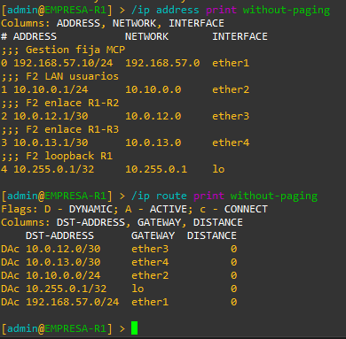

*Figura 7: Direccionamiento y rutas conectadas de EMPRESA-R1.*

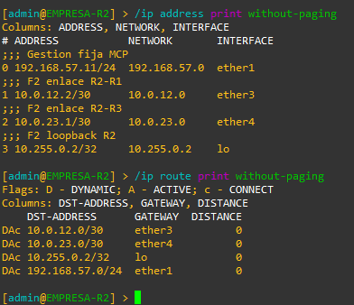

*Figura 8: Direccionamiento y rutas conectadas de EMPRESA-R2.*

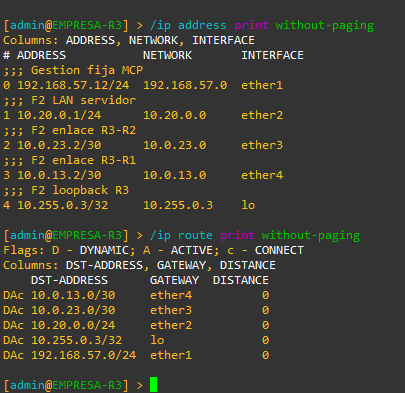

*Figura 9: Direccionamiento y rutas conectadas de EMPRESA-R3.*

### 2.5. Pruebas entre routers

Se ejecutaron pings con dirección de origen explícita para comprobar cada enlace de datos.

#### Desde R1

```routeros
/ping address=10.0.12.2 src-address=10.0.12.1 count=5
/ping address=10.0.13.2 src-address=10.0.13.1 count=5
```

#### Desde R2

```routeros
/ping address=10.0.12.1 src-address=10.0.12.2 count=5
/ping address=10.0.23.2 src-address=10.0.23.1 count=5
```

#### Desde R3

```routeros
/ping address=10.0.23.1 src-address=10.0.23.2 count=5
/ping address=10.0.13.1 src-address=10.0.13.2 count=5
```

| Prueba | Resultado observado |
|---|---|
| R1 → R2 | 5 enviados, 5 recibidos |
| R2 → R1 | 5 enviados, 5 recibidos |
| R2 → R3 | 5 enviados, 5 recibidos |
| R3 → R2 | 5 enviados, 5 recibidos |
| R1 → R3 | 5 enviados, 5 recibidos |
| R3 → R1 | 5 enviados, 5 recibidos |

Los tres enlaces respondieron en ambos sentidos, sin pérdidas en estas pruebas.

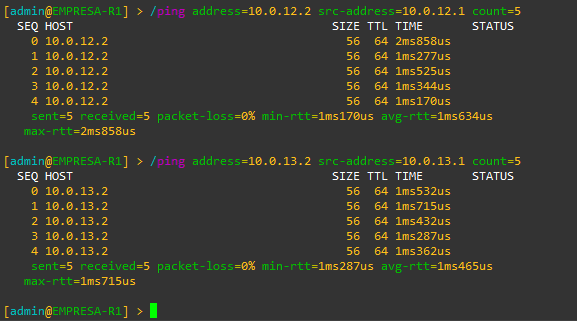

*Figura 10: Verificación de los enlaces desde EMPRESA-R1.*


*Figura 11: Verificación de los enlaces desde EMPRESA-R2.*

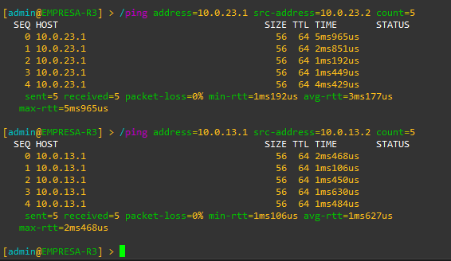

*Figura 12: Verificación de los enlaces desde EMPRESA-R3.*

### 2.6. Pruebas de los hosts

En cada VPCS se consultó su configuración y se realizó un ping al gateway.

#### EMPRESA-PC

```text
show ip
ping 10.10.0.1
```

#### EMPRESA-SRV

```text
show ip
ping 10.20.0.1
```

| Host | Dirección | Gateway | Resultado observado |
|---|---|---|---|
| EMPRESA-PC | 10.10.0.10/24 | 10.10.0.1 | 5 respuestas de 5 |
| EMPRESA-SRV | 10.20.0.10/24 | 10.20.0.1 | 5 respuestas de 5 |

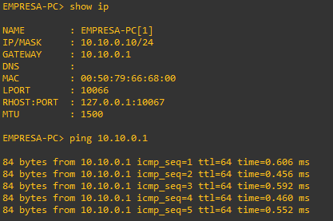

*Figura 13: Conectividad de EMPRESA-PC con R1.*

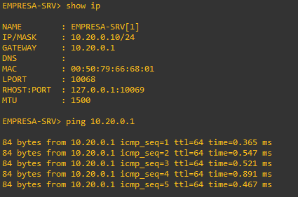

*Figura 14: Conectividad de EMPRESA-SRV con R3.*

### 2.7. Resultado

Quedaron configuradas las direcciones internas y las loopbacks de los tres routers, junto con las direcciones y gateways de las dos VPCS.

Se comprobó conectividad en ambos sentidos de los enlaces entre routers y desde cada host hacia su gateway.

La comunicación entre LAN se verificará en F3, después de configurar OSPF.

## Fase 3 — Enrutamiento OSPF

### 3.1. Objetivo

Intercambiar rutas entre los tres routers mediante OSPF y comprobar la comunicación entre las LAN, utilizando el enlace directo R1–R3 como camino preferido.

### 3.2. Configuración aplicada

Se creó una instancia OSPFv2 por router y se utilizaron las direcciones de las loopbacks como Router ID. Los tres equipos pertenecen al área backbone `0.0.0.0`.

Los comandos ya fueron aplicados. Antes de repetir instrucciones `add`, comprobar las entradas existentes para evitar duplicados.

#### EMPRESA-R1

```routeros
/routing ospf instance add name=ospf-v2 version=2 router-id=10.255.0.1
/routing ospf area add name=backbone instance=ospf-v2 area-id=0.0.0.0
/routing ospf interface-template add area=backbone interfaces=ether3 type=ptp cost=20 comment="F3 R1-R2"
/routing ospf interface-template add area=backbone interfaces=ether4 type=ptp cost=10 comment="F3 R1-R3"
/routing ospf interface-template add area=backbone interfaces=ether2 passive cost=1 comment="F3 LAN usuarios"
/routing ospf interface-template add area=backbone interfaces=lo passive cost=1 comment="F3 loopback R1"
```

#### EMPRESA-R2

```routeros
/routing ospf instance add name=ospf-v2 version=2 router-id=10.255.0.2
/routing ospf area add name=backbone instance=ospf-v2 area-id=0.0.0.0
/routing ospf interface-template add area=backbone interfaces=ether3 type=ptp cost=20 comment="F3 R2-R1"
/routing ospf interface-template add area=backbone interfaces=ether4 type=ptp cost=20 comment="F3 R2-R3"
/routing ospf interface-template add area=backbone interfaces=lo passive cost=1 comment="F3 loopback R2"
```

#### EMPRESA-R3

```routeros
/routing ospf instance add name=ospf-v2 version=2 router-id=10.255.0.3
/routing ospf area add name=backbone instance=ospf-v2 area-id=0.0.0.0
/routing ospf interface-template add area=backbone interfaces=ether3 type=ptp cost=20 comment="F3 R3-R2"
/routing ospf interface-template add area=backbone interfaces=ether4 type=ptp cost=10 comment="F3 R3-R1"
/routing ospf interface-template add area=backbone interfaces=ether2 passive cost=1 comment="F3 LAN servidor"
/routing ospf interface-template add area=backbone interfaces=lo passive cost=1 comment="F3 loopback R3"
```

En esta versión de RouterOS, las interfaces pasivas se configuran con `passive`, sin `=yes`.

### 3.3. Decisiones tomadas

- **Área única:** los tres routers pertenecen al backbone; no se requiere un diseño multiárea para este laboratorio.
- **Router ID explícitos:** permiten identificar los equipos de forma estable.
- **Enlaces punto a punto:** cada enlace conecta dos routers, por lo que se utiliza `type=ptp`, sin elección de DR y BDR.
- **Interfaces pasivas:** las LAN y loopbacks se anuncian sin formar vecindades por ellas.
- **Gestión excluida:** no se creó una plantilla para `ether1` ni se redistribuyeron todas las redes conectadas.
- **Costos diferenciados:** el enlace R1–R3 tiene costo 10 y cada enlace por R2 tiene costo 20. Esto favorece el camino directo.

Las interfaces pasivas de LAN y loopback tienen costo 1. La autenticación OSPF no se configura en esta fase.

### 3.4. Verificación de vecinos y rutas

Se consultaron:

```routeros
/routing ospf neighbor print detail without-paging
/routing ospf interface print detail without-paging
/ip route print without-paging
```

Se comprobó que cada router tiene dos vecinos en estado `Full`:

| Router | Vecinos y sus Router ID |
|---|---|
| R1 | R2 — 10.255.0.2 y R3 — 10.255.0.3 |
| R2 | R1 — 10.255.0.1 y R3 — 10.255.0.3 |
| R3 | R1 — 10.255.0.1 y R2 — 10.255.0.2 |

Las LAN y loopbacks aparecen como pasivas. `ether1` no participa en OSPF.

Las rutas aprendidas se identifican con la bandera `o`. Las rutas activas muestran además la bandera `A`.

| Router | Red remota | Siguiente salto observado |
|---|---|---|
| R1 | 10.20.0.0/24 | 10.0.13.2, por ether4 |
| R2 | 10.10.0.0/24 | 10.0.12.1, por ether3 |
| R2 | 10.20.0.0/24 | 10.0.23.2, por ether4 |
| R3 | 10.10.0.0/24 | 10.0.13.1, por ether4 |

En R2 se observaron dos rutas de igual costo hacia `10.0.13.0/30`, identificadas con `+` de ECMP. Corresponden a caminos por R1 y R3; no son entradas duplicadas incorrectamente.

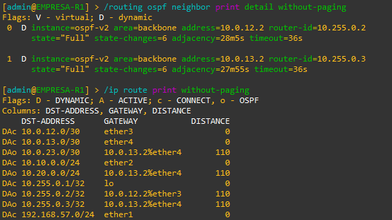

*Figura 15: Vecindades y rutas de EMPRESA-R1.*

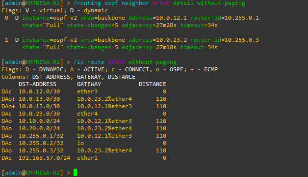

*Figura 16: Vecindades y rutas de EMPRESA-R2.*

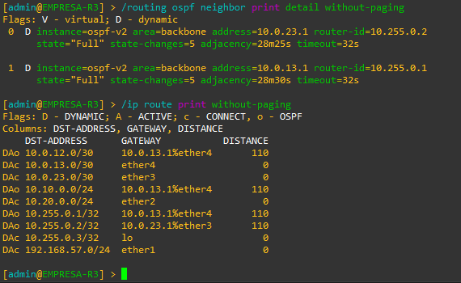

*Figura 17: Vecindades y rutas de EMPRESA-R3.*

### 3.5. Comunicación entre las LAN

Desde EMPRESA-PC:

```text
ping 10.20.0.10
trace 10.20.0.10
```

Desde EMPRESA-SRV:

```text
ping 10.10.0.10
```

| Prueba | Resultado |
|---|---|
| PC → SRV | 5 respuestas de 5 |
| SRV → PC | 5 respuestas de 5 |

El traceroute desde PC mostró:

| Salto | Dirección | Equipo |
|---|---|---|
| 1 | 10.10.0.1 | R1 |
| 2 | 10.0.13.2 | R3 |
| 3 | 10.20.0.10 | SRV |

Se confirmó el uso del enlace directo R1–R3.

La respuesta final `Destination port unreachable` corresponde al puerto UDP cerrado utilizado por traceroute. El destino fue alcanzado; no representa una falla del enrutamiento.

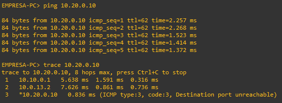

*Figura 18: Comunicación hacia SRV y comprobación del camino principal.*

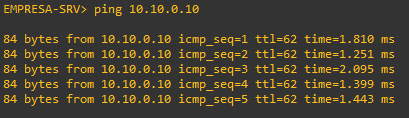

*Figura 19: Comunicación desde la LAN del servidor hacia la LAN de usuarios.*

### 3.6. Resultado

Los tres routers establecieron vecindades FULL y aprendieron las redes remotas mediante OSPF.

Se verificó comunicación entre los hosts en ambos sentidos y preferencia del enlace directo R1–R3. La red de gestión quedó excluida del protocolo.

La recuperación ante caída del enlace principal no se ensayó en esta fase. El siguiente paso será aplicar las políticas de seguridad.

## Fase 4 — Seguridad

### 4.1. Objetivo

Restringir la administración, separar los permisos de consulta y configuración, autenticar OSPF y comprobar las comunicaciones permitidas y bloqueadas.

El equipo Windows administrador utiliza `192.168.57.1`. Se verificó este origen antes de restringir los accesos SSH.

Los comandos documentan la configuración aplicada. Las instrucciones `add` no deben repetirse sin comprobar las entradas existentes. 

Los comandos muestran nombres de ejemplo en lugar de las contraseñas y claves reales. Para reproducirlos, deben reemplazarse localmente por valores propios.

### 4.2. Decisiones de diseño y tecnologías

Se utilizaron las funciones nativas de RouterOS:

- **SSH:** acceso remoto a los routers con autenticación de usuario y verificación de clave de host.
- **Usuarios y grupos:** separación entre administración y consulta.
- **Firewall IPv4:** protección del propio router y control del tránsito.
- **HMAC-SHA256:** autenticación de los mensajes OSPF.
- **Contadores y consultas:** observación del filtrado, las vecindades y las rutas.

Se consideraron estas alternativas:

| Tecnología | Decisión |
|---|---|
| mTLS | No se implementó mTLS propio. El diseño utiliza SSH para acceder a los routers y Secure MCP Tunnel para conectar el servidor local con ChatGPT. No se despliega un servicio HTTPS propio que requiera autenticación mediante certificados mutuos. |
| eBPF security | No se utilizan herramientas de seguridad basadas en eBPF porque la demo se implementa sobre MikroTik CHR y no incluye una plataforma Linux o Kubernetes administrada por el grupo para ese fin. El firewall nativo de RouterOS permite aplicar la política, reproducir el bloqueo y verificar la corrección mediante contadores y pruebas de conectividad, por lo que cubre el escenario definido. |

La selección responde a la arquitectura del laboratorio. No implica equivalencia entre tecnologías ni una comparación experimental de seguridad o rendimiento.

### 4.3. Usuarios y permisos

Se configuraron estas cuentas en los tres routers:

| Cuenta | Grupo | Uso | Origen SSH autorizado |
|---|---|---|---|
| netadmin | full | Administración | 192.168.57.1/32 |
| mcp_ro | tp4-lectura | Consultas | 192.168.57.1/32 |
| admin | full | Cuenta predeterminada deshabilitada | — |

El grupo de consulta tiene únicamente los permisos de lectura y SSH:

```routeros
/user group add name=tp4-lectura policy=ssh,read
```

Se asignaron seis contraseñas distintas de 32 caracteres, una por
cuenta y router. Las credenciales se almacenan localmente en `.env`
y no se incluyen en las capturas ni en la documentación.

Los comandos equivalentes de creación son:

```routeros
/user add name=netadmin group=full address=192.168.57.1/32 password="CLAVE_UNICA_ADMINISTRADOR"
/user add name=mcp_ro group=tp4-lectura address=192.168.57.1/32 password="CLAVE_UNICA_LECTURA"
```

Después de comprobar nuevas conexiones con netadmin, se deshabilitó admin y se cerraron sus sesiones anteriores:

```routeros
/user disable [find where name="admin"]
```

Verificación:

```routeros
/user print
/user group print detail where name="tp4-lectura"
```

La bandera `X` identifica a admin como deshabilitado. Los permisos precedidos por `!` no están habilitados.

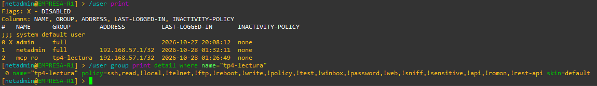

*Figura 20: Cuentas y grupo de consulta de EMPRESA-R1.*

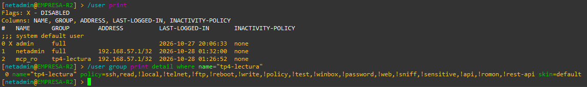

*Figura 21: Cuentas y grupo de consulta de EMPRESA-R2.*

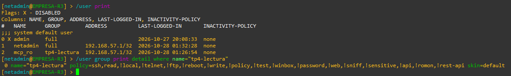

*Figura 22: Cuentas y grupo de consulta de EMPRESA-R3.*

### 4.4. Servicios e interfaces

#### Servicios de administración

En los tres routers se deshabilitaron los servicios que no utiliza el laboratorio:

```routeros
/ip service disable [find where name="telnet"]
/ip service disable [find where name="ftp"]
/ip service disable [find where name="www"]
/ip service disable [find where name="www-ssl"]
/ip service disable [find where name="api"]
/ip service disable [find where name="api-ssl"]
/ip service disable [find where name="winbox"]
```

SSH permanece habilitado. Su acceso IPv4 se restringe mediante las cuentas y el firewall.

También se deshabilitaron MAC Telnet, MAC WinBox, MAC Ping y el descubrimiento de vecinos:

```routeros
/tool mac-server set allowed-interface-list=none
/tool mac-server mac-winbox set allowed-interface-list=none
/tool mac-server ping set enabled=no
/ip neighbor discovery-settings set discover-interface-list=none
```

Esto reduce mecanismos innecesarios de acceso y descubrimiento. La consola de GNS3 se conserva como recuperación local.

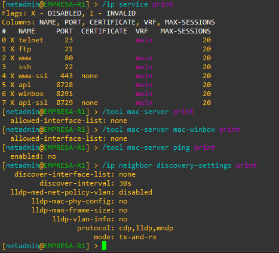

*Figura 23: Servicios de R1, representativos de la configuración aplicada a los tres routers.*

#### Interfaces sin uso

Se deshabilitaron los puertos Ethernet que no participan en el cableado:

| Router | Interfaces conservadas | Interfaces deshabilitadas |
|---|---|---|
| R1 | ether1, ether2, ether3 y ether4 | ether5, ether6, ether7 y ether8 |
| R2 | ether1, ether3 y ether4 | ether2, ether5, ether6, ether7 y ether8 |
| R3 | ether1, ether2, ether3 y ether4 | ether5, ether6, ether7 y ether8 |

La interfaz `lo` permanece habilitada en los tres routers.

Comandos comunes:

```routeros
/interface ethernet disable [find where name="ether5"]
/interface ethernet disable [find where name="ether6"]
/interface ethernet disable [find where name="ether7"]
/interface ethernet disable [find where name="ether8"]
```

Comando adicional en R2:

```routeros
/interface ethernet disable [find where name="ether2"]
```

Se evita así utilizar accidentalmente puertos ajenos al diseño. Las capturas de la sección 4.8 incluyen su verificación.

### 4.5. Protección del propio router mediante IPv4

La cadena `input` controla los paquetes destinados a cualquiera de las direcciones locales del router, independientemente de la interfaz por la que ingresen.

#### Reglas iniciales comunes

En los tres routers:

```routeros
/ip firewall filter add chain=input action=accept connection-state=established,related comment=TP4-IN-EST
/ip firewall filter add chain=input action=drop connection-state=invalid comment=TP4-IN-INVALID
/ip firewall filter add chain=input action=accept in-interface=ether1 src-address=192.168.57.1/32 protocol=tcp dst-port=22 comment=TP4-IN-SSH
/ip firewall filter add chain=input action=accept in-interface=ether1 src-address=192.168.57.1/32 protocol=icmp comment=TP4-IN-MGMT-PING
```

Las nuevas conexiones SSH se autorizan únicamente desde el equipo administrador y por la interfaz de gestión.

#### Permisos OSPF de EMPRESA-R1

```routeros
/ip firewall filter add chain=input action=accept in-interface=ether3 src-address=10.0.12.2/32 protocol=ospf comment=TP4-IN-OSPF3
/ip firewall filter add chain=input action=accept in-interface=ether4 src-address=10.0.13.2/32 protocol=ospf comment=TP4-IN-OSPF4
```

#### Permisos OSPF de EMPRESA-R2

```routeros
/ip firewall filter add chain=input action=accept in-interface=ether3 src-address=10.0.12.1/32 protocol=ospf comment=TP4-IN-OSPF3
/ip firewall filter add chain=input action=accept in-interface=ether4 src-address=10.0.23.2/32 protocol=ospf comment=TP4-IN-OSPF4
```

#### Permisos OSPF de EMPRESA-R3

```routeros
/ip firewall filter add chain=input action=accept in-interface=ether3 src-address=10.0.23.1/32 protocol=ospf comment=TP4-IN-OSPF3
/ip firewall filter add chain=input action=accept in-interface=ether4 src-address=10.0.13.1/32 protocol=ospf comment=TP4-IN-OSPF4
```

#### Reglas finales comunes

En los tres routers:

```routeros
/ip firewall filter add chain=input action=accept in-interface=!ether1 src-address=10.0.0.0/8 dst-address=!192.168.57.0/24 protocol=icmp comment=TP4-IN-DATA-PING
/ip firewall filter add chain=input action=drop comment=TP4-IN-DROP
```

Se permite ICMP de diagnóstico desde las redes internas, excluyendo como destino la red de gestión. Los paquetes no autorizados por las reglas anteriores alcanzan el descarte final.

Por ejemplo, un ping desde PC a la IP de gestión de R1 ingresa por ether2 y se procesa en input. La exclusión de destino impide que lo acepte TP4-IN-DATA-PING.

El filtrado de OSPF por origen e interfaz se complementa con la autenticación de la sección 4.8.

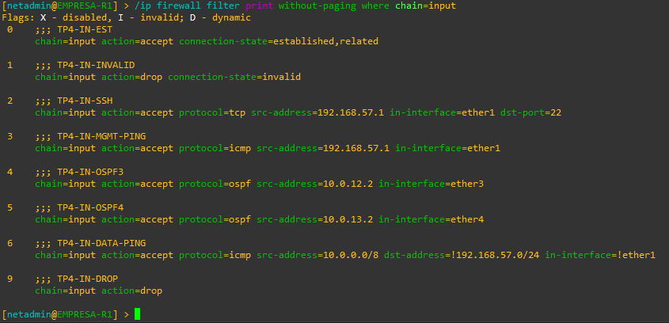

*Figura 24: Protección IPv4 del propio router.*

### 4.6. Tráfico IPv4 en tránsito

En los tres routers se impide utilizar la interfaz de gestión como camino de tránsito:

```routeros
/ip firewall filter add chain=forward action=drop in-interface=ether1 comment=TP4-NO-MGMT-IN
/ip firewall filter add chain=forward action=drop out-interface=ether1 comment=TP4-NO-MGMT-OUT
```

La política de datos del escenario se concentra en R1. Después de esas dos reglas se configuraron:

```routeros
/ip firewall filter add chain=forward action=accept connection-state=established,related comment=TP4-FWD-EST
/ip firewall filter add chain=forward action=drop connection-state=invalid comment=TP4-FWD-INVALID
/ip firewall filter add chain=forward action=accept src-address=10.10.0.10 dst-address=10.20.0.10 protocol=icmp comment=TP4-FWD-PERMITIDO
/ip firewall filter add chain=forward action=drop comment=TP4-FWD-DROP
```

PC puede iniciar tráfico ICMP hacia SRV. Las respuestas se aceptan mediante seguimiento de conexiones. Los demás accesos nuevos que atraviesan R1 se descartan.

Tanto el camino directo R1–R3 como la alternativa R1–R2–R3 atraviesan R1. R2 y R3 no tienen un descarte general del tránsito de datos.

No se utiliza FastTrack para mantener observable el recorrido por las reglas y sus contadores.

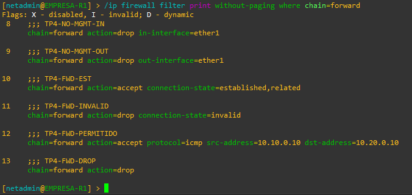

*Figura 25: Política de tránsito aplicada en R1.*

### 4.7. Tratamiento de IPv6

La demostración utiliza únicamente IPv4. En los tres routers se bloqueó la entrada y el tránsito IPv6:

```routeros
/ipv6 firewall filter add chain=input action=drop comment=TP4-IPV6-IN-DROP
/ipv6 firewall filter add chain=forward action=drop comment=TP4-IPV6-FWD-DROP
```

IPv6 permanece habilitado en el sistema. Estas reglas bloquean los paquetes destinados al router y los que intentan atravesarlo; no deshabilitan la pila ni filtran su tráfico de salida.

Se verificó la presencia de ambas reglas en cada equipo:

```routeros
/ipv6 firewall filter export terse
```

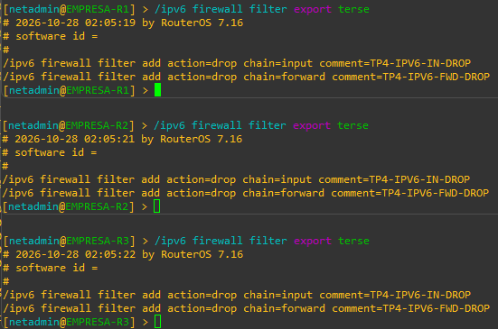

*Figura 26: Configuración del descarte de entrada y tránsito IPv6.*

### 4.8. Autenticación OSPF

Se incorporó HMAC-SHA256 en los tres enlaces entre routers, con `auth-id=1`.

| Enlace | Extremo A | Extremo B | Clave |
|---|---|---|---|
| R1–R2 | R1 ether3 | R2 ether3 | Exclusiva del enlace |
| R2–R3 | R2 ether4 | R3 ether3 | Exclusiva del enlace |
| R1–R3 | R1 ether4 | R3 ether4 | Exclusiva del enlace |

Se asignaron tres claves distintas de 32 caracteres hexadecimales,
una por enlace. Ambos extremos de cada enlace comparten su clave
correspondiente. Las claves se almacenan localmente en `.env`
y no se incluyen en la documentación ni en las capturas.

Los comandos equivalentes utilizan marcadores:

#### EMPRESA-R1

```routeros
/routing ospf interface-template set [find where interfaces="ether3"] auth=sha256 auth-id=1 auth-key="CLAVE_ENLACE_R1_R2"
/routing ospf interface-template set [find where interfaces="ether4"] auth=sha256 auth-id=1 auth-key="CLAVE_ENLACE_R1_R3"
```

#### EMPRESA-R2

```routeros
/routing ospf interface-template set [find where interfaces="ether3"] auth=sha256 auth-id=1 auth-key="CLAVE_ENLACE_R1_R2"
/routing ospf interface-template set [find where interfaces="ether4"] auth=sha256 auth-id=1 auth-key="CLAVE_ENLACE_R2_R3"
```

#### EMPRESA-R3

```routeros
/routing ospf interface-template set [find where interfaces="ether3"] auth=sha256 auth-id=1 auth-key="CLAVE_ENLACE_R2_R3"
/routing ospf interface-template set [find where interfaces="ether4"] auth=sha256 auth-id=1 auth-key="CLAVE_ENLACE_R1_R3"
```

La autenticación verifica los mensajes mediante una clave compartida. No cifra los anuncios ni sustituye el firewall.

Las LAN y loopbacks permanecen pasivas. La interfaz de gestión sigue excluida de OSPF.

Se verificaron las interfaces, el método de autenticación y los vecinos sin mostrar claves:

```routeros
/interface ethernet print without-paging
/routing ospf interface-template print without-paging proplist=interfaces,auth,auth-id,passive
/routing ospf neighbor print detail without-paging
```

Cada router mantuvo dos vecinos Full. Las rutas a las LAN remotas permanecieron activas y el camino principal continuó siendo R1–R3.

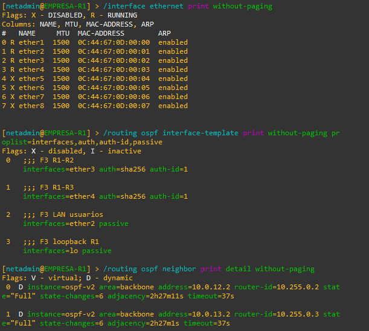

*Figura 27: Interfaces deshabilitadas y autenticación OSPF de R1.*

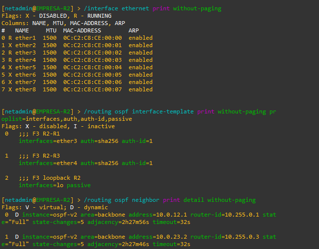

*Figura 28: Interfaces deshabilitadas y autenticación OSPF de R2.*

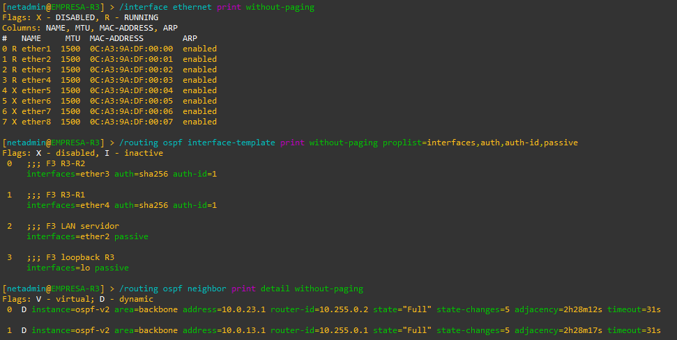

*Figura 29: Interfaces deshabilitadas y autenticación OSPF de R3.*

### 4.9. Validación de los controles

#### 4.9.1. Tráfico permitido y bloqueado

Desde EMPRESA-PC:

```text
ping 10.20.0.10
ping 10.255.0.3
ping 10.10.0.1
ping 192.168.57.10
```

| Destino | Resultado observado |
|---|---|
| SRV — 10.20.0.10 | 5 respuestas de 5 |
| Loopback de R3 — 10.255.0.3 | 5 timeouts |
| Gateway — 10.10.0.1 | 5 respuestas de 5 |
| Gestión de R1 — 192.168.57.10 | 5 timeouts |

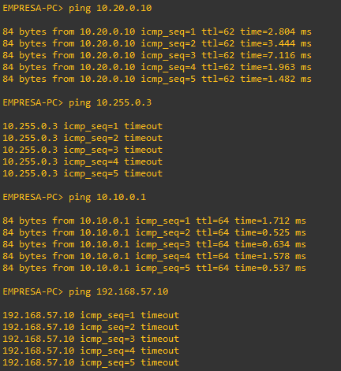

*Figura 30: Comprobación de destinos permitidos y bloqueados.*

En R1 se consultaron los contadores:

```routeros
/ip firewall filter print stats without-paging
```

TP4-FWD-PERMITIDO, TP4-FWD-DROP y TP4-IN-DATA-PING registraron 20 paquetes acumulados cada una, frente a los 15 de la captura anterior. El incremento es coherente con cinco intentos hacia SRV, la loopback protegida y el gateway, respectivamente.

TP4-IN-DROP registró 183 paquetes acumulados. Incluye otros tráficos descartados y no permite atribuir su totalidad al ping hacia gestión.

Los contadores son acumulativos; sus valores pueden aumentar al repetir las pruebas.

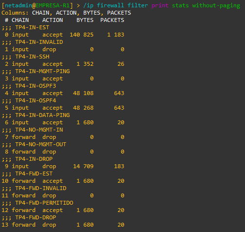

*Figura 31: Contadores acumulados de aceptación y descarte.*

#### 4.9.2. Permisos de consulta

Se comprobó en los tres routers que mcp_ro puede leer la identidad y no puede modificarla.

Ejemplo en R1:

```routeros
/system identity print
/system identity set name=EMPRESA-R1
```

La escritura fue rechazada con `not enough permissions (9)`. Se utilizó el nombre existente para evitar un cambio efectivo si la operación se aceptaba inesperadamente.

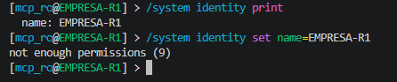

*Figura 32: Lectura permitida y escritura rechazada en R1.*

#### 4.9.3. Continuidad de OSPF después del firewall

Se consultaron las vecindades:

```routeros
/routing ospf neighbor print detail without-paging
```

Después de aplicar el firewall se conservaron los vecinos Full. Las capturas de la sección 4.8 muestran también la verificación posterior a la autenticación.

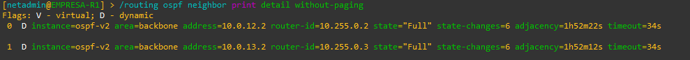

*Figura 33: Continuidad de OSPF después del filtrado.*

#### 4.9.4. Prueba negativa de autenticación OSPF

Se cambió temporalmente la clave de la plantilla ether3 de R1 por una clave de prueba distinta de la configurada en R2. No se modificaron las interfaces, los costos ni el firewall.

El ensayo se realizó sobre R1–R2 para conservar el enlace principal R1–R3. La clave original se recuperó desde `.env` y se restauró al finalizar.

Durante la prueba se consultaron los vecinos de ambos routers:

```routeros
/routing ospf neighbor print detail without-paging
```

| Estado | R1 | R2 |
|---|---|---|
| Claves diferentes | Solo R3 permanece Full | Solo R3 permanece Full |
| Clave correcta restaurada | R2 y R3 aparecen Full | R1 y R3 aparecen Full |

La vecindad R1–R2 desapareció de ambos listados durante la discrepancia de claves. Las vecindades con R3 permanecieron Full.

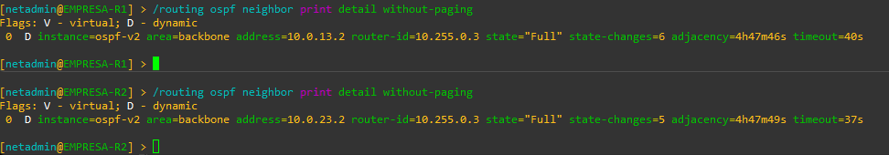

*Figura 34: Pérdida de la vecindad R1–R2 al introducir una clave incorrecta.*

Después de restaurar la clave correcta, ambos routers recuperaron sus dos vecinos Full. Las capturas muestran una antigüedad menor para la vecindad recuperada que para las conexiones con R3.

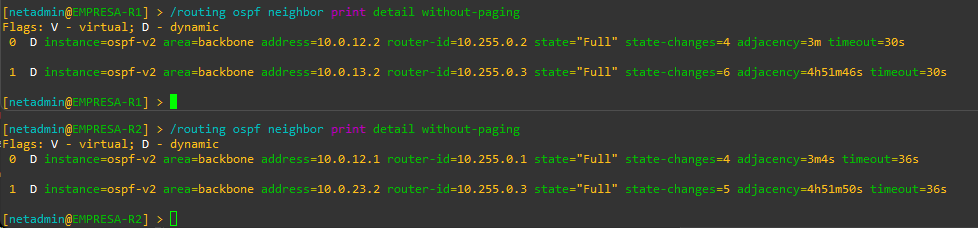

*Figura 35: Recuperación de R1–R2 después de restaurar la clave.*

El ensayo comprobó la pérdida y recuperación de una vecindad al modificar únicamente la clave de un extremo. No se midió el tiempo exacto de detección ni se capturaron paquetes o mensajes específicos de rechazo.

#### 4.9.5. Acceso al puerto SSH desde distintos orígenes

Desde EMPRESA-R2 se intentó conectar al puerto SSH de R1:

```routeros
/system telnet address=192.168.57.10 port=22
```

El cliente Telnet se utilizó como sonda TCP al puerto 22. No se habilitó el servicio Telnet ni se enviaron credenciales.

El intento desde R2, con origen `192.168.57.11`, no estableció conexión. Este origen no está autorizado por la regla de acceso SSH de R1.

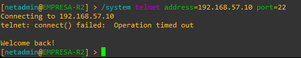

*Figura 36: Intento de conexión al puerto SSH desde un origen no autorizado.*

Como comprobación positiva, desde Windows se inició una sesión:

```powershell
ssh netadmin@192.168.57.10
```

Dentro de ella se consultó:

```routeros
/system identity print
```

La conexión desde `192.168.57.1` permitió autenticarse y consultar la identidad EMPRESA-R1.

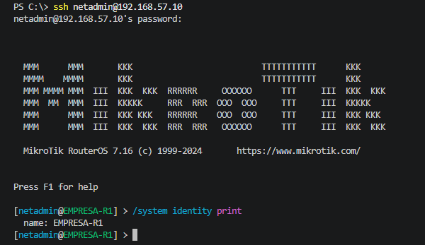

*Figura 37: Acceso SSH desde el equipo administrador autorizado.*

Esta comparación verifica el bloqueo de conexión desde el origen ensayado y el acceso desde Windows. No constituye una prueba de contraseñas incorrectas ni de todos los posibles orígenes de red.

### 4.10. Supuestos y limitaciones

El laboratorio prepara un escenario de diagnóstico y corrección de una regla de firewall en un entorno separado. Se consideran confiables el equipo administrador, el hipervisor y los routers; no se simula el compromiso de un dispositivo.

| Aspecto | Alcance y límite |
|---|---|
| Filtrado de datos | La política se aplica en R1, por donde pasan ambos caminos PC–SRV. No garantiza la misma restricción para tráfico de otros segmentos que no atraviese R1. |
| Gestión | Se separa mediante interfaz y filtrado, sin VRF independiente. Su protección depende de la configuración de acceso y firewall. |
| Suplantación | No se implementaron controles específicos contra falsificación de direcciones de origen. La restricción por IP no sustituye la autenticación. |
| Disponibilidad | No se realizaron pruebas de saturación ni se configuraron límites específicos de ICMP. |
| Recuperación administrativa | Si Windows no está disponible, se conserva la consola de GNS3 como acceso local. |
| IPv6 | Se verificaron las reglas de entrada y tránsito, sin una prueba de tráfico. La pila permanece habilitada. |
| Pruebas negativas | OSPF se ensayó en R1–R2 y el puerto SSH se probó desde R2 hacia R1. No se repitieron todas las combinaciones de equipos y orígenes. |
| Hosts y consolas | PC y SRV son simuladores VPCS, sin autenticación propia de consola ni controles de un sistema operativo completo. Sus consolas Telnet no cifran el tráfico y deben mantenerse restringidas al entorno de administración de GNS3. La demo evalúa el filtrado de red, no la seguridad de los hosts finales. |

Se eligió VPCS porque las pruebas requieren únicamente direccionamiento
y conectividad ICMP. Utilizar hosts Linux permitiría evaluar usuarios,
servicios y controles locales, pero ampliaría el alcance sin ser
necesario para validar la propuesta de la demo.

Las pruebas respaldan los comportamientos observados; no constituyen una auditoría completa ni acreditan resistencia general frente a ataques.

Antes de trasladar el diseño a producción sería necesario revisar las fronteras de confianza y evaluar filtrado adicional, validación de orígenes, aislamiento de gestión y controles de disponibilidad.

### 4.11. Resultado y continuidad

Quedaron configuradas las cuentas y restricciones de administración, los servicios mínimos, las interfaces utilizadas, el firewall IPv4, el descarte de entrada y tránsito IPv6 y la autenticación OSPF.

Se comprobó:

- Lectura permitida y escritura rechazada con mcp_ro.
- Conectividad de PC con SRV y su gateway.
- Bloqueo desde PC hacia la loopback protegida y la gestión de R1.
- Conservación de vecinos y rutas OSPF después del filtrado.
- Pérdida de la vecindad R1–R2 con una clave incorrecta y recuperación al restaurarla.
- Bloqueo del puerto SSH desde R2 y acceso administrativo desde Windows.

La cuenta netadmin se reserva para administración. En F6, la integración con EMPRESA utilizará exclusivamente mcp_ro; las modificaciones de la demostración se permitirán únicamente en GEMELO.

Los requisitos para reproducir el acceso de gestión en otra computadora se documentan en [la guía de la demo](README.md).

La falla intencional de firewall prevista para F7 todavía no se introdujo.


## Fase 5 — Preparación del gemelo

### 5.1. Objetivo

Crear un proyecto independiente de EMPRESA que reproduzca la configuración y el comportamiento necesarios para probar correcciones sin modificar la red de referencia.

Se conservaron la topología, las direcciones internas, las loopbacks, los costos OSPF y las políticas de firewall. Se diferenciaron las identidades, las direcciones y MAC de gestión y las credenciales de acceso.

### 5.2. Copia y separación de proyectos

Con los nodos de EMPRESA detenidos se creó una copia del proyecto mediante Guardar como, denominada GEMELO.

Durante la adaptación se mantuvo EMPRESA detenida para evitar conflictos con las direcciones y MAC heredadas de la copia.

Los nodos del nuevo proyecto se identificaron como:

- GEMELO-R1, GEMELO-R2 y GEMELO-R3.
- GEMELO-PC y GEMELO-SRV.

Las LAN y los enlaces de datos de ambos proyectos permanecen separados. Únicamente las interfaces de gestión se conectan a la misma red Host-only.

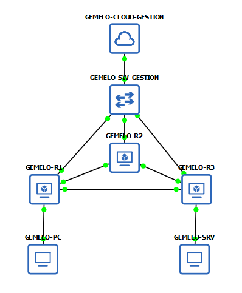

*Figura 38: Proyecto GEMELO con sus nodos y conexiones.*

### 5.3. Identidades y direccionamiento de gestión

Se asignaron las siguientes identidades y direcciones:

| Router | Identidad en EMPRESA | Gestión EMPRESA | Identidad en GEMELO | Gestión GEMELO |
|---|---|---|---|---|
| R1 | EMPRESA-R1 | 192.168.57.10/24 | GEMELO-R1 | 192.168.57.20/24 |
| R2 | EMPRESA-R2 | 192.168.57.11/24 | GEMELO-R2 | 192.168.57.21/24 |
| R3 | EMPRESA-R3 | 192.168.57.12/24 | GEMELO-R3 | 192.168.57.22/24 |

Los cambios se realizaron desde las consolas de GNS3.

#### GEMELO-R1

```routeros
/system identity set name=GEMELO-R1
/ip address set [find where address="192.168.57.10/24" and interface="ether1"] address=192.168.57.20/24 comment="Gestion GEMELO"
```

#### GEMELO-R2

```routeros
/system identity set name=GEMELO-R2
/ip address set [find where address="192.168.57.11/24" and interface="ether1"] address=192.168.57.21/24 comment="Gestion GEMELO"
```

#### GEMELO-R3

```routeros
/system identity set name=GEMELO-R3
/ip address set [find where address="192.168.57.12/24" and interface="ether1"] address=192.168.57.22/24 comment="Gestion GEMELO"
```

El administrador conserva `192.168.57.1`. Por ello no fue necesario ampliar los orígenes autorizados en las cuentas ni en el firewall.

### 5.4. Direcciones MAC y recuperación de referencias

La copia conservaba las MAC de EMPRESA. Como las interfaces de gestión comparten VMnet1, se asignaron MAC diferentes a GEMELO.

Con cada router detenido, se modificó su MAC base desde Configure → Network de GNS3:

| Router | MAC base de GEMELO |
|---|---|
| R1 | 02:47:4D:00:01:01 |
| R2 | 02:47:4D:00:02:01 |
| R3 | 02:47:4D:00:03:01 |

GNS3 asignó las MAC siguientes a las restantes tarjetas de cada router.

Al reiniciar, RouterOS detectó las tarjetas como interfaces nuevas, con nombres ether9–ether16. Las direcciones, las plantillas OSPF y algunas reglas de firewall conservaron referencias a las interfaces anteriores y quedaron inválidas.

Se recuperó esta correspondencia:

| Interfaz detectada | Nombre utilizado en el diseño |
|---|---|
| ether9 | ether1 |
| ether10 | ether2 |
| ether11 | ether3 |
| ether12 | ether4 |
| ether13 | ether5 |
| ether14 | ether6 |
| ether15 | ether7 |
| ether16 | ether8 |

En cada router se renombraron las interfaces:

```routeros
/interface ethernet set [find where name="ether9"] name=ether1
/interface ethernet set [find where name="ether10"] name=ether2
/interface ethernet set [find where name="ether11"] name=ether3
/interface ethernet set [find where name="ether12"] name=ether4
/interface ethernet set [find where name="ether13"] name=ether5
/interface ethernet set [find where name="ether14"] name=ether6
/interface ethernet set [find where name="ether15"] name=ether7
/interface ethernet set [find where name="ether16"] name=ether8
```

Después se reasignaron las entradas existentes. No se recrearon las reglas ni se reemplazaron las claves OSPF.

#### Direcciones de GEMELO-R1

```routeros
/ip address set [find where address="192.168.57.20/24"] interface=ether1
/ip address set [find where address="10.10.0.1/24"] interface=ether2
/ip address set [find where address="10.0.12.1/30"] interface=ether3
/ip address set [find where address="10.0.13.1/30"] interface=ether4
```

#### Direcciones de GEMELO-R2

```routeros
/ip address set [find where address="192.168.57.21/24"] interface=ether1
/ip address set [find where address="10.0.12.2/30"] interface=ether3
/ip address set [find where address="10.0.23.1/30"] interface=ether4
```

#### Direcciones de GEMELO-R3

```routeros
/ip address set [find where address="192.168.57.22/24"] interface=ether1
/ip address set [find where address="10.20.0.1/24"] interface=ether2
/ip address set [find where address="10.0.23.2/30"] interface=ether3
/ip address set [find where address="10.0.13.2/30"] interface=ether4
```

#### Referencias comunes de firewall y DHCP

En los tres routers:

```routeros
/ip firewall filter set [find where comment="TP4-IN-SSH"] in-interface=ether1
/ip firewall filter set [find where comment="TP4-IN-MGMT-PING"] in-interface=ether1
/ip firewall filter set [find where comment="TP4-IN-OSPF3"] in-interface=ether3
/ip firewall filter set [find where comment="TP4-IN-OSPF4"] in-interface=ether4
/ip firewall filter set [find where comment="TP4-IN-DATA-PING"] in-interface=!ether1
/ip firewall filter set [find where comment="TP4-NO-MGMT-IN"] in-interface=ether1
/ip firewall filter set [find where comment="TP4-NO-MGMT-OUT"] out-interface=ether1

/ip dhcp-client set [find] interface=ether1 disabled=yes
```

#### Plantillas OSPF

En GEMELO-R1:

```routeros
/routing ospf interface-template set [find where comment="F3 R1-R2"] interfaces=ether3
/routing ospf interface-template set [find where comment="F3 R1-R3"] interfaces=ether4
/routing ospf interface-template set [find where comment="F3 LAN usuarios"] interfaces=ether2
```

En GEMELO-R2:

```routeros
/routing ospf interface-template set [find where comment="F3 R2-R1"] interfaces=ether3
/routing ospf interface-template set [find where comment="F3 R2-R3"] interfaces=ether4
```

En GEMELO-R3:

```routeros
/routing ospf interface-template set [find where comment="F3 R3-R2"] interfaces=ether3
/routing ospf interface-template set [find where comment="F3 R3-R1"] interfaces=ether4
/routing ospf interface-template set [find where comment="F3 LAN servidor"] interfaces=ether2
```

Se restableció la deshabilitación de ether5–ether8 en los tres routers y de ether2 en R2, conforme a F4. Las loopbacks conservaron sus referencias a `lo`.

La revisión confirmó direcciones y reglas sin referencias inválidas y dos vecinos OSPF Full por router.

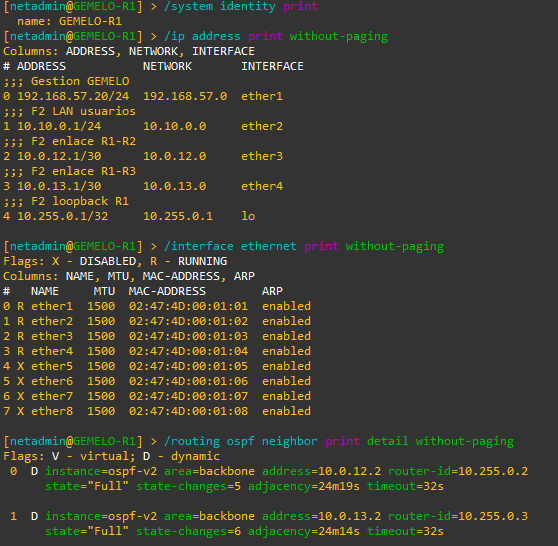

*Figura 39: Direccionamiento, MAC y vecindades de GEMELO-R1.*

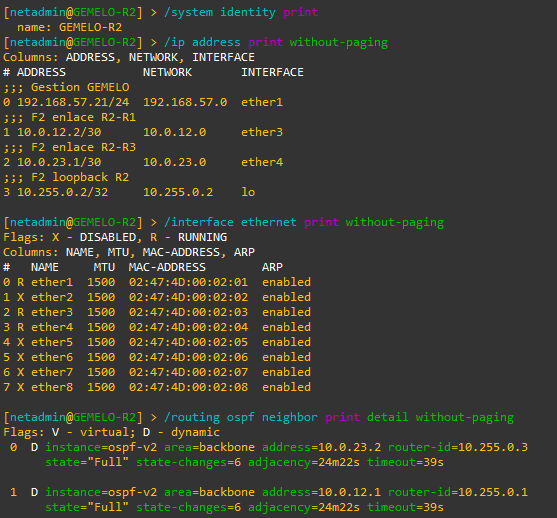

*Figura 40: Direccionamiento, MAC y vecindades de GEMELO-R2.*

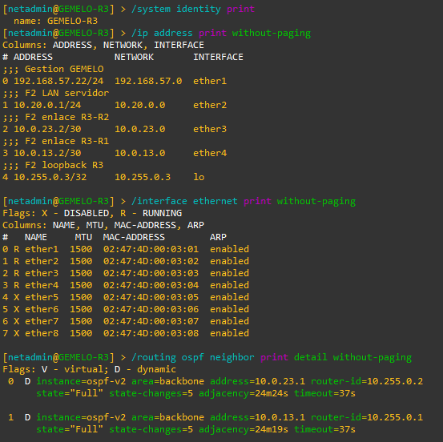

*Figura 41: Direccionamiento, MAC y vecindades de GEMELO-R3.*

### 5.5. Credenciales y acceso administrativo

Se asignaron seis contraseñas nuevas de 32 caracteres, una por cuenta y router de GEMELO. Se conservaron las cuentas netadmin y mcp_ro, sus grupos y la restricción de origen `192.168.57.1/32`.

Las credenciales se almacenan localmente en `.env`, con variables separadas de EMPRESA:

```text
GEMELO_R1_NETADMIN_PASSWORD
GEMELO_R1_READ_PASSWORD
GEMELO_R2_NETADMIN_PASSWORD
GEMELO_R2_READ_PASSWORD
GEMELO_R3_NETADMIN_PASSWORD
GEMELO_R3_READ_PASSWORD
```

Se comprobaron conexiones SSH nuevas con ambas cuentas en los tres routers. Las contraseñas de EMPRESA no se modificaron.

Desde Windows se verificó la correspondencia entre dirección e identidad:

```powershell
ssh netadmin@192.168.57.20
ssh netadmin@192.168.57.21
ssh netadmin@192.168.57.22
```

Cada conexión se realiza por separado. Dentro de la sesión:

```routeros
/system identity print
/quit
```

| Dirección | Identidad verificada |
|---|---|
| 192.168.57.20 | GEMELO-R1 |
| 192.168.57.21 | GEMELO-R2 |
| 192.168.57.22 | GEMELO-R3 |

También se comprobó el acceso a EMPRESA con sus credenciales correspondientes.

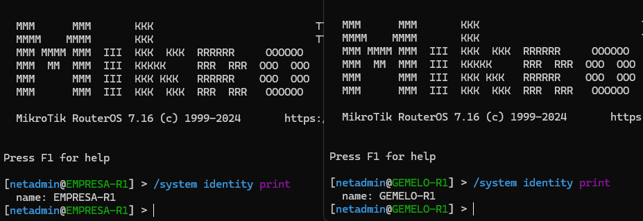

*Figura 42: Acceso a instancias distintas mediante sus direcciones de gestión.*

### 5.6. Ejecución simultánea

Se habilitó en las propiedades de los proyectos la opción de mantenerlos ejecutándose en segundo plano al cambiar de proyecto.

Se mantuvieron encendidos GNS3, la GNS3 VM y los nodos de ambos entornos.

Desde Windows se comprobó el alcance de las seis direcciones:

```powershell
$direcciones = @(
    "192.168.57.10", "192.168.57.11", "192.168.57.12",
    "192.168.57.20", "192.168.57.21", "192.168.57.22"
)

foreach ($ip in $direcciones) {
    Write-Host "`n--- $ip ---"
    ping.exe -n 2 $ip
}
```

Las seis direcciones respondieron a la comprobación de conectividad
con ambos proyectos encendidos. La captura muestra el resultado
positivo para cada destino.

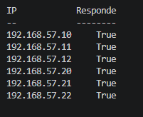

*Figura 43: Acceso de gestión con EMPRESA y GEMELO encendidos.*

Las IP internas pueden repetirse porque las redes de datos no están conectadas entre proyectos. Las IP y MAC de gestión son distintas porque comparten el segmento Host-only.

### 5.7. Hosts y equivalencia funcional

Se ajustaron los nombres de las VPCS para respetar el máximo de 12 caracteres.

En la PC:

```text
set pcname GEMELO-PC
save
```

En el servidor:

```text
set pcname GEMELO-SRV
save
```

Se conservaron las direcciones del escenario:

| Host | Dirección | Gateway |
|---|---|---|
| GEMELO-PC | 10.10.0.10/24 | 10.10.0.1 |
| GEMELO-SRV | 10.20.0.10/24 | 10.20.0.1 |

Desde GEMELO-PC se verificó:

```text
show ip
ping 10.20.0.10
ping 10.255.0.3
ping 10.10.0.1
ping 192.168.57.20
```

| Destino | Resultado observado |
|---|---|
| SRV — 10.20.0.10 | 5 respuestas de 5 |
| Loopback de R3 — 10.255.0.3 | 5 timeouts |
| Gateway — 10.10.0.1 | 5 respuestas de 5 |
| Gestión de GEMELO-R1 — 192.168.57.20 | 5 timeouts |

GEMELO reprodujo el comportamiento permitido y bloqueado documentado para EMPRESA. La comprobación es funcional y se limita a estas pruebas y a las vecindades OSPF verificadas.

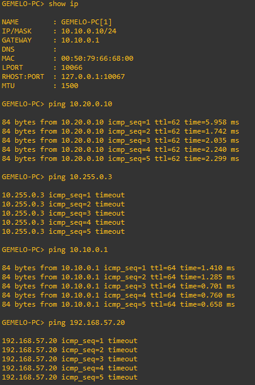

*Figura 44: Comprobación funcional del escenario en GEMELO.*

### 5.8. Independencia del almacenamiento

Se compararon las líneas de ejecución de QEMU de EMPRESA-R1 y GEMELO-R1.

Los archivos de disco activo se encuentran en rutas distintas:

```text
EMPRESA-R1:
/opt/gns3/projects/7e9e4c35-b1ae-4d4a-a70b-24e2031d7abf/project-files/qemu/756e0b3e-6864-4594-9cb6-3a872471f0f5/hda_disk.qcow2

GEMELO-R1:
/opt/gns3/projects/b997c264-29b4-491e-a83b-c0847ca7507c/project-files/qemu/df17494c-16e7-4fff-9542-fb47294e2c8a/hda_disk.qcow2
```

El nombre común `hda_disk.qcow2` no implica que sea el mismo archivo. Las rutas corresponden a proyectos y nodos diferentes.

La independencia del almacenamiento se comprobó sobre R1 como
muestra representativa. No se inspeccionaron individualmente los
discos de R2 y R3.


### 5.9. Resultado y alcance

Quedó preparado GEMELO como proyecto separado, con identidades, direcciones y MAC de gestión y credenciales de acceso propias.

Se verificaron:

- Acceso simultáneo a las seis direcciones de gestión.
- Correspondencia entre IP e identidad mediante SSH.
- Acceso con las nuevas credenciales de GEMELO.
- Dos vecinos OSPF Full por router del gemelo.
- Comportamiento esperado del tráfico permitido y bloqueado.
- Rutas de disco activo diferentes en el par R1 inspeccionado.

La equivalencia comprobada corresponde al escenario definido. No se realizó una comparación exhaustiva de todos los parámetros ni se implementó sincronización automática.

Las claves OSPF se conservaron de la copia; no forman parte de las seis contraseñas de usuario renovadas. Las redes de datos de ambos proyectos permanecen separadas.

En F6 se incorporará GEMELO al inventario definitivo de herramientas, con lectura en EMPRESA y modificaciones controladas únicamente en GEMELO.

La falla intencional de firewall todavía no se introdujo.

## Fase 6 — Integración de IA mediante MCP

### 6.1. Objetivo y funcionamiento

Se implementó un servidor MCP en Python para permitir que la IA consulte EMPRESA y utilice GEMELO como entorno de diagnóstico, experimentación y validación de cambios.

La integración utiliza herramientas generales: la IA selecciona los comandos, interpreta las respuestas y decide qué comprobar a continuación. No contiene una función que identifique o corrija automáticamente la falla del escenario.

El recorrido de comunicación es:

**ChatGPT → Secure MCP Tunnel → servidor MCP local → routers por SSH o extremos VPCS por consola Telnet.**

El servidor se ejecuta localmente y se comunica con el cliente del túnel mediante stdio. El túnel proporciona la conexión con ChatGPT sin publicar directamente los routers ni las consolas en Internet.

### 6.2. Separación de acceso entre entornos

| Entorno | Cuenta o acceso | Capacidades |
|---|---|---|
| EMPRESA | SSH con `mcp_ro` | Consultas sujetas a los permisos de lectura de RouterOS |
| GEMELO | SSH con `mcp_ro` | Consultas de configuración y estado |
| GEMELO | SSH con `netadmin` | Ejecución de comandos administrativos en los tres routers |
| GEMELO-PC y GEMELO-SRV | Consolas VPCS | Consultas, pruebas de conectividad y configuración |

El inventario es fijo. La herramienta administrativa admite exclusivamente routers de GEMELO, y esta separación también se valida en la capa de ejecución. El servidor no carga credenciales administrativas de EMPRESA.

Dentro de GEMELO no se restringen los comandos a una falla, protocolo o subsistema determinado. La IA puede trabajar con los permisos de `netadmin`, incluidos cambios que podrían afectar su propia conectividad.

Las conexiones SSH verifican la clave de host registrada en `known_hosts`, la identidad del router y la MAC de su interfaz de gestión antes de ejecutar los comandos.

Implementación: [configuracion.py](mcp/configuracion.py) y [conexion_ssh.py](mcp/conexion_ssh.py).

### 6.3. Herramientas definitivas

| Herramienta | Parámetros | Función |
|---|---|---|
| `listar_routers` | Sin parámetros | Presenta los seis routers y señala dónde se permite administración |
| `consultar_router` | `equipo`, `comando` | Ejecuta una consulta elegida por la IA mediante `mcp_ro` |
| `ejecutar_comando_gemelo` | `equipo`, `comando` | Ejecuta comandos con `netadmin` exclusivamente en GEMELO |
| `ejecutar_comando_vpcs` | `equipo`, `comando` | Ejecuta un comando en GEMELO-PC o GEMELO-SRV |

Las consultas no dependen de una lista cerrada de operaciones. La protección de EMPRESA se apoya en los permisos de su cuenta de RouterOS y en la ausencia de acceso administrativo desde el MCP.

Las herramientas se publican con anotaciones que distinguen lectura y administración. Estas anotaciones describen su comportamiento al cliente; no sustituyen los controles de acceso.

Implementación: [servidor_mcp.py](mcp/servidor_mcp.py) y [operaciones_router.py](mcp/operaciones_router.py).

### 6.4. Acceso a los extremos del gemelo

Se incorporó acceso a las consolas de ambos VPCS para realizar pruebas desde los extremos, además de consultar los routers.

| Equipo | Dirección del servidor GNS3 | Puerto de consola |
|---|---|---|
| GEMELO-PC | `192.168.57.130` | `5010` |
| GEMELO-SRV | `192.168.57.130` | `5012` |

La conexión procesa la negociación Telnet y verifica el prompt esperado antes de enviar el comando. Cada llamada admite un comando VPCS.

El estado `completado` indica que regresó el prompt, no que la operación haya tenido éxito. Por ejemplo, un ping puede completar su ejecución y devolver únicamente timeouts; la IA debe interpretar esa salida.

Estas consolas no incorporan autenticación propia. Su acceso depende del aislamiento y la protección de la red de administración del laboratorio.

Implementación: [consolas_gemelo.py](mcp/consolas_gemelo.py).

### 6.5. Actualización, diagnóstico y cierre de intervenciones

La actualización de GEMELO se realiza a solicitud del usuario. La IA consulta EMPRESA, identifica diferencias relevantes y ejecuta los cambios necesarios en GEMELO, conservando las diferencias intencionales de gestión, identidades, MAC y credenciales.

No se implementó sincronización continua ni se considera que una comparación parcial demuestre equivalencia completa entre ambos escenarios.

Las instrucciones del servidor establecen el siguiente procedimiento:

1. Investigar EMPRESA mediante lectura.
2. Comprobar o reproducir el síntoma en GEMELO.
3. Sustentar el diagnóstico con configuración, estado y pruebas.
4. Aplicar y validar la corrección exclusivamente en GEMELO.
5. Presentar recomendaciones para EMPRESA pendientes de aplicación por su administrador.

Al finalizar, se solicita un informe en Markdown dentro del chat, con diagnóstico, acciones justificadas, comandos relevantes, resultados y limitaciones. No se agregó una herramienta para escribir informes en el equipo local.

Estas instrucciones orientan el comportamiento de la IA; no constituyen una garantía de que todas las respuestas sigan exactamente el mismo formato o procedimiento.

Definición de instrucciones y herramientas: [servidor_mcp.py](mcp/servidor_mcp.py).

### 6.6. Configuración local y arranque

Las credenciales se mantienen en `demo/mcp/.env`, excluido del repositorio. Se utilizan tres contraseñas de lectura para EMPRESA y seis para GEMELO, correspondientes a sus cuentas de lectura y administración.

El archivo también contiene los parámetros del túnel y las direcciones de las consolas. Las claves de autenticación OSPF no son necesarias para establecer estas conexiones.

El entorno virtual y `tunnel-client.exe` permanecen fuera del control de versiones. Las dependencias se declaran en [requirements.txt](mcp/requirements.txt).

El script [iniciar.py](mcp/iniciar.py) permite:

```bash
# Crear el perfil local del túnel.
./demo/mcp/.venv/Scripts/python.exe demo/mcp/iniciar.py --configurar

# Comprobar su configuración.
./demo/mcp/.venv/Scripts/python.exe demo/mcp/iniciar.py --doctor

# Iniciar el túnel.
./demo/mcp/.venv/Scripts/python.exe demo/mcp/iniciar.py
```

El perfil apunta al intérprete del entorno virtual y a `servidor_mcp.py`. El cliente del túnel inicia el servidor MCP; no es necesario ejecutar ambos por separado.

Para utilizar la integración deben permanecer activos los proyectos de GNS3, sus equipos y el cliente del túnel.

### 6.7. Verificaciones realizadas

Se verificaron las conexiones SSH de lectura a los seis routers y las conexiones administrativas a los tres routers de GEMELO.

La prueba de protocolo comprobó:

- Inicialización de la sesión MCP y publicación de las cuatro herramientas.
- Consultas generales a EMPRESA y GEMELO con `mcp_ro`.
- Ejecución de una consulta mediante `netadmin` en GEMELO.
- Rechazo de EMPRESA y destinos desconocidos en la herramienta administrativa.
- Acceso a ambas consolas VPCS mediante MCP.
- Rechazo de consolas fuera del inventario de GEMELO.

Las verificaciones pueden ejecutarse mediante:

```bash
./demo/mcp/.venv/Scripts/python.exe demo/mcp/servidor_mcp.py --verificar
./demo/mcp/.venv/Scripts/python.exe demo/mcp/verificar_mcp.py
```

Implementación: [verificar_mcp.py](mcp/verificar_mcp.py).

También se comprobó la integración desde ChatGPT y se ensayó la reproducción de un bloqueo de firewall en GEMELO. La IA relacionó los pings fallidos con el incremento del contador de la regla, la deshabilitó en GEMELO-R1 y verificó la recuperación de respuestas. EMPRESA permaneció sin modificaciones desde la integración.

La conectividad permitida hacia SRV y el bloqueo hacia la loopback protegida se comprobaron mediante las consolas automatizadas. La conservación de restricciones después de cada intervención debe validarse específicamente; no se deduce únicamente de estas pruebas iniciales.

### 6.8. Alcance y limitaciones

La integración permite investigar problemas mediante comandos generales, pero la calidad del diagnóstico depende del razonamiento de la IA y de las evidencias disponibles.

El acceso administrativo puede producir cambios incorrectos o interrumpir la conexión con GEMELO. El MCP no implementa reversión automática de configuraciones. Ante una ejecución inconclusa se debe consultar el estado antes de repetir operaciones.

Las verificaciones de identidad y MAC están asociadas al inventario configurado. Si se modifican intencionalmente esos valores, será necesario actualizarlo para restablecer el acceso verificado.

Las pruebas con VPCS acreditan conectividad y comportamiento de filtrado dentro del alcance ensayado. No representan la validación de servicios de aplicación ni la seguridad de sistemas operativos completos.

## Fase 7 — Escenario de falla y validación

Pendiente: introducir la falla en ambos entornos, diagnosticarla y probar la corrección únicamente en GEMELO.

## Fase 8 — Ensayos y respaldo

Pendiente: registrar tres ejecuciones completas, ajustar la demo a 3–5 minutos y comprobar el respaldo grabado.
